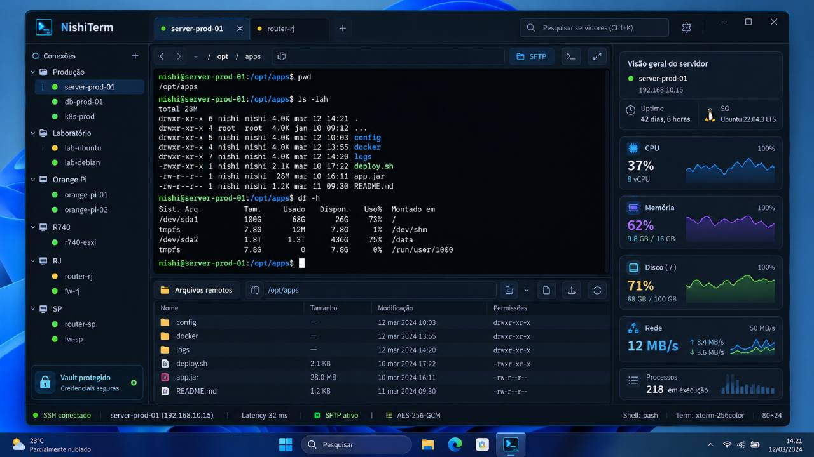

# Referência visual — NishiTerm

Mockup enviado pelo usuário em 24/10/2026, preservado sem alterações em [references/nishiterm-mockup.jpg](references/nishiterm-mockup.jpg). Origem: anexo `1000116425.jpg`, imagem 1280 × 720. Esta referência orienta o produto futuro; não representa funcionalidades já implementadas ou resultados medidos.

## Composição observada

- Janela desktop escura, em tons azul-marinho, com bordas discretas, painéis compactos e destaque azul na seleção. Terminal com fundo quase preto e fonte monoespaçada; texto de interface em fonte sem serifa.
- Barra superior com marca NishiTerm, abas de sessões, indicadores de estado, fechamento de aba, ação de nova aba, busca de servidores com indicação Ctrl+K e configurações.
- Navegação esquerda com conexões agrupadas em árvore, expansão de grupos, seleção de host e indicadores verdes/amarelos. Exemplos de grupos: Produção, Laboratório, Orange Pi e localidades. Nomes, endereços e grupos são dados ilustrativos, não inventário real a cadastrar.
- Terminal como superfície principal, acima do explorador remoto. Barra com caminho, navegação e ação SFTP. O conteúdo exemplifica shell Linux, cores ANSI e comandos comuns.
- Painel inferior de arquivos remotos, caminho e tabela com nome, tamanho, modificação e permissões; ícones de ações. As operações exatas dos ícones precisam ser especificadas, não deduzidas como suporte já existente.
- Coluna direita com identidade/IP, uptime e sistema operacional, CPU, memória, disco, rede e processos, usando valores e pequenos gráficos.
- Cartão “Vault protegido” no rodapé da navegação.
- Barra de status inferior com SSH, host/IP, latência, SFTP, cifra, shell, tipo e dimensões do terminal.

A área de trabalho, wallpaper e barra de tarefas do Windows pertencem ao cenário da imagem e não devem ser reproduzidos dentro do aplicativo.

## Direção funcional e fases

| ID | Elemento representado | Tratamento planejado |
|---|---|---|
| V01 | Tema escuro e terminal dominante | Base visual da futura UI; preservar legibilidade, foco de teclado e redimensionamento real do PTY |
| V02 | Árvore e busca Ctrl+K | Perfis/grupos e busca local na fase 3; persistir metadados separados de segredos |
| V03 | Abas de sessões | Fase 3; estado, terminal, fila e cancelamento independentes por sessão |
| V04 | Cofre protegido | Fase 3, após desenho e testes de credenciais; nunca exibir “protegido” antes de existir proteção efetiva |
| V05 | Explorador SFTP | Candidato à fase 4; especificar operações, transferências, limites, cancelamento e política de sobrescrita antes de implementar |
| V06 | Métricas e visão do servidor | Candidato à fase 4; definir plataformas compatíveis e coleta opcional, com timeout e frequência limitada |
| V07 | Caminho e status detalhado | Evoluir por capacidades reais; estado indisponível quando não for possível obter a informação com segurança |

O mockup estabelece a referência visual e evidencia estas áreas de produto. Não resolve todos os comportamentos nem obriga a implementar todos os painéis na PoC. SFTP e métricas precisam de escopo funcional antes de entrar no MVP. Túneis, sincronização, broadcast e plugins não são mostrados e continuam sem requisito confirmado.

## Decisões e cuidados para implementação futura

1. Manter o terminal utilizável em janelas menores: painéis secundários recolhíveis, tamanho mínimo e redimensionamento do PTY. Proporções do mockup são referência, não medidas fixas; não reduzir a fonte para acomodar todos os painéis.
2. Abas ocultas também exigem política de consumo: buffers limitados, scrollback limitado e ACK associado ao processamento. Nunca manter fila ilimitada porque uma aba está em segundo plano.
3. Não inferir diretório remoto a partir do texto do prompt. Terminal e SFTP têm caminhos independentes até haver mecanismo explícito de sincronização com o shell.
4. Coleta de métricas não deve escrever comandos no terminal interativo nem disputar sua fila de saída. Roteadores, appliances e sistemas sem os comandos esperados devem mostrar “indisponível”, sem exigir instalação ou privilégio remoto.
5. Não confundir pontos verdes/amarelos com monitoramento contínuo de todos os hosts. Definir semântica de estados e complementar cores com texto/ícone acessível. Nenhuma conexão em segundo plano apenas para preencher indicadores.
6. Valores, séries, latência e cifra do mockup são exemplos. Na UI funcional, exibir dados reais, data da última coleta e estado de erro/indisponibilidade. Não fixar AES-256-GCM, bash ou xterm-256color como descrições de capacidades não verificadas.
7. Testar fechamento da sessão enquanto SFTP ou coleta estão ativos; compartilhar identidade verificada e ciclo de vida, com limites e cancelamento por operação. Escolher reutilização ou separação do transporte após medir interferência no terminal.

## Aceitação visual futura

Comparar capturas da aplicação com esta referência quanto à hierarquia: conexões à esquerda, abas no topo, terminal central dominante, arquivos abaixo, métricas à direita e status inferior. Verificar contraste, teclado, foco visível e estados de erro, além de Windows em DPI 100/150/200%. A comparação visual não substitui testes funcionais e não deve exigir reprodução de dados fictícios.

## Pendências de produto

A conversa completa ainda não foi recuperada. Permanecem a especificar: operações SFTP necessárias, plataformas e métricas suportadas, comportamento de busca/grupos, bloqueio/desbloqueio do cofre e sincronização de caminhos. O envio da imagem resolve a ausência do mockup, não essas decisões de comportamento.

## Recorte implementado após aprovação

V01–V03 implementados na etapa 3A: tema escuro, árvore de perfis/grupos, busca Ctrl+K, quatro abas e status. Barra lateral recolhível. Grupos derivados dos perfis; busca por nome, grupo, host e usuário. Status não monitora hosts sem conexão e indica pausa nas abas ocultas.

V04–V06 permanecem futuros. Não foram adicionados painéis vazios de SFTP/métricas nem indicadores fictícios de cofre. [Capturas e limites](evidence/product-ui/README.md). DPI e teclado no Windows pendentes para esta UI.

## Identidades gerenciadas e cofre — atualização autorizada

O cadastro usa confirmação de chave na primeira conexão, ligada à mesma sessão, sem autenticação antes do aceite. Chave divergente bloqueia. Caminho known_hosts externo é opcional e mantém modo estrito. Perfis antigos preservam o caminho; limpar em opções avançadas e reabrir aba ativa o gerenciamento. Ver [HOST_TRUST.md](HOST_TRUST.md).

Cofre inicial implementado com senha mestra própria, sem admin, Argon2id/AES-256-GCM, gravação criptografada explícita, bloqueio manual e após 5 minutos sem uso. Perfis não contêm segredos; resolução ocorre no backend com vínculo ao destino. Ver uso, limites e gates pendentes em [CREDENTIALS.md](CREDENTIALS.md). Estas decisões substituem as restrições históricas de senha apenas/arquivo obrigatório/cofre futuro.
