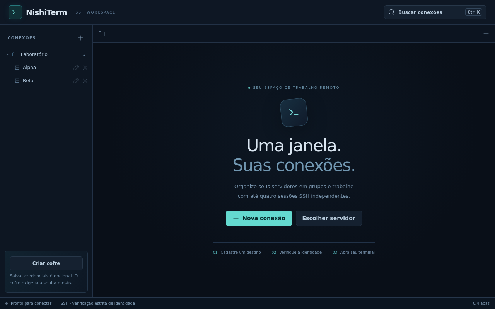
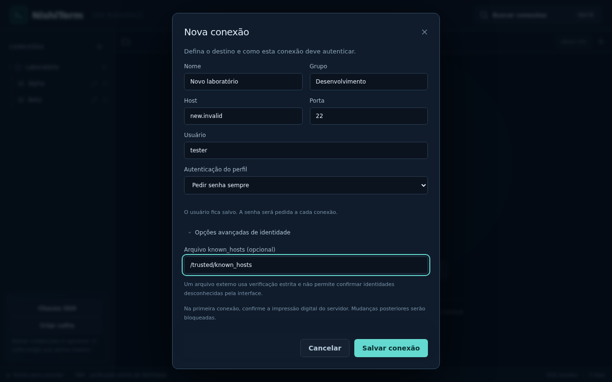
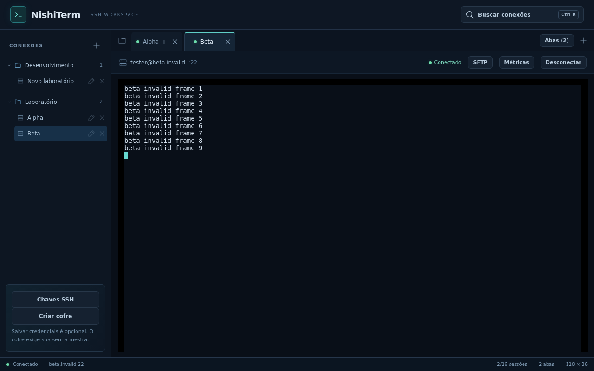
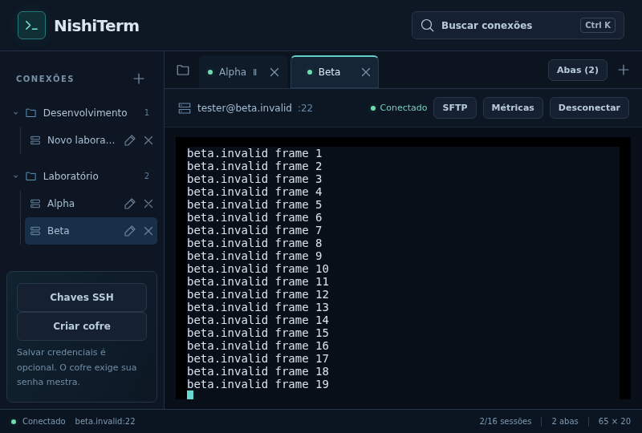
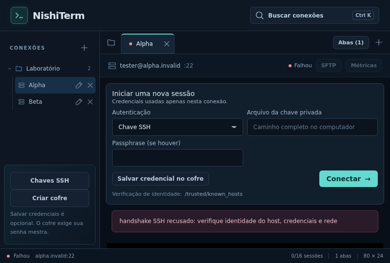
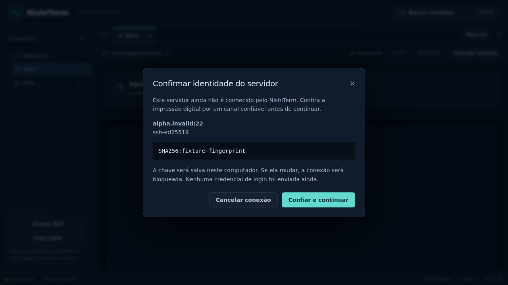
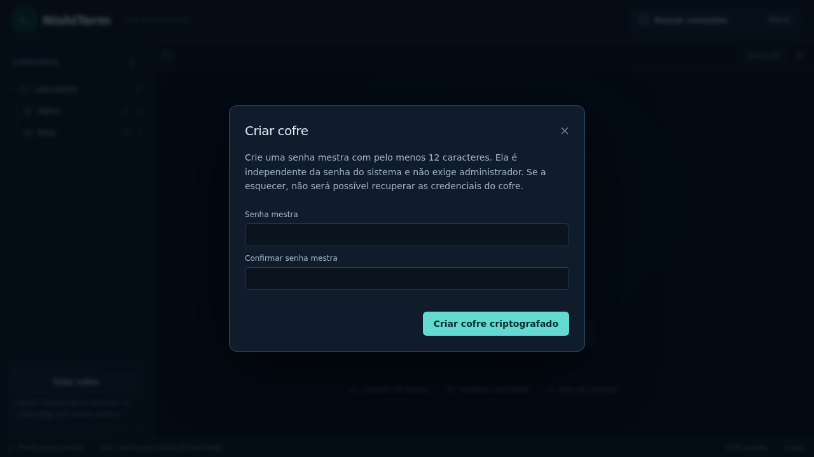
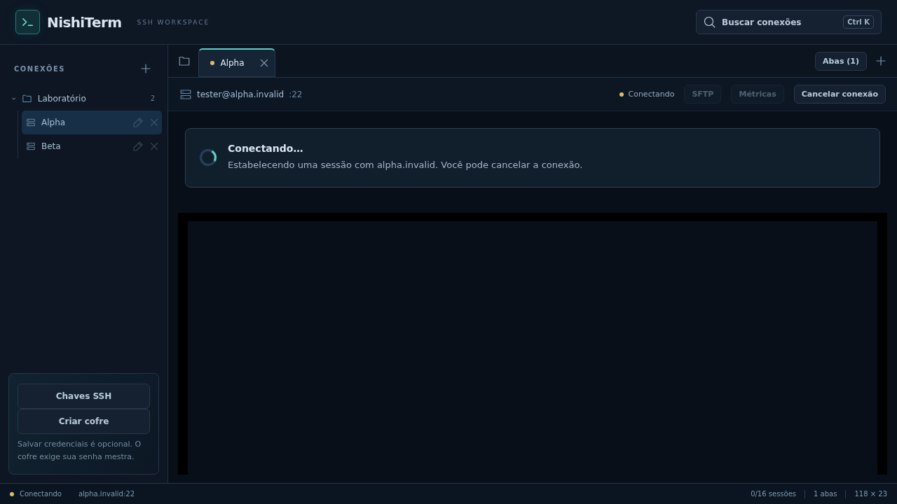
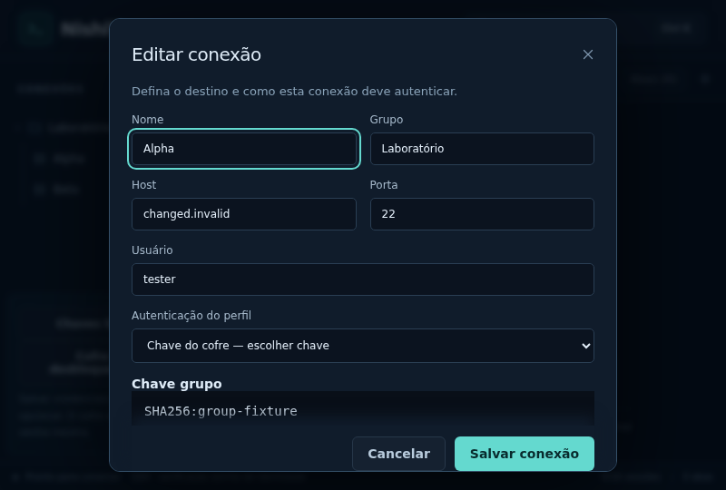

# Capturas da área de trabalho

Capturadas pela suíte Playwright em 24/10/2026, no Chrome/Linux, com bridge Wails **simulado**. Perfis Alpha/Beta e endereços `.invalid` são fixtures. Texto do terminal e estado conectado são simulados: estas imagens não comprovam SSH real nem execução Windows. O aplicativo normal não inclui essas fixtures.

## Área de trabalho — 1280×800

## Cadastro de conexão

## Abas — 1280×800

## Janela compacta — 800×540

As capturas foram inspecionadas visualmente. O teste aguarda o ajuste do xterm antes de capturar os terminais. Reprodução: `CHROME_PATH=/usr/bin/google-chrome npm test --prefix frontend`. Ver [guia e limitações](../../PRODUCT_WORKSPACE.md).

## Autenticação por chave — 800×540

Captura adicional do fluxo de chave com bridge simulado. A mensagem de erro é produzida pela fixture; não é falha de conexão real.

## Confirmação da identidade e criação do cofre

Ambas as imagens usam bridge simulado, sem host real ou credencial preenchida.

## Conexão em andamento

## Chave do cofre no cadastro — 800×540

Bridge simulado, nome/fingerprint fictícios, sem chave privada, senha mestra ou códigos preenchidos. O cenário altera o destino e exige associação explícita; bloqueio durante a edição pede novo desbloqueio antes de salvar. Não representa SSH real nem ensaio Windows.

### Observabilidade (26/10/2026)

`metrics-fixture.png` e `metrics-compact-fixture.png`: painel de CPU/memória/disco/rede/uptime em 1280×720 e 800×540. Dados são fixtures declaradas do bridge de teste, não medições reais. Mostram as primeiras amostras de uma janela de cinco minutos; séries preenchem gradualmente. Testes verificam falhas e pausa ao ocultar/recolher. O layout compacto usa painel lateral sobreposto e rolagem interna.
